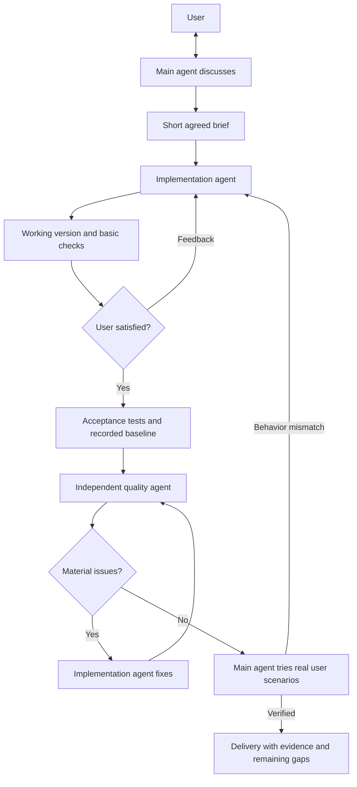

# Agent Development Workflow

Delegate outcomes to capable agents. Keep prompts short, iterate with the user, and let executable checks provide evidence.

One [workflow skill](skills/workflow/SKILL.md) coordinates discussion, implementation, independent quality checks, and real-user acceptance.

## How it works



### Core Roles & Ownership

- **Main Agent**: Owns the discussion, delegation, scope boundaries, feedback coordination, and final acceptance.
- **Implementation Agent**: Owns technical decisions, code changes, and bug fixes.
- **Quality Agent**: Performs independent code review and deterministic checks (CRAP and mutation testing).
- **Rule**: Start subagents with fresh contexts where supported. Reuse the implementer across feedback and repairs. Never run multiple writers against the same files concurrently.

The skill's [SKILL.md](skills/workflow/SKILL.md) defines the full process: run sizing, the five stages, and their completion criteria. Role references under [`skills/workflow/references/`](skills/workflow/references/) hold what each subagent needs.

---

## Install and use

```sh
npx skills add itzLan1126/Workflow
```

Add `--global` for a user-wide installation. Use your client's explicit invocation syntax, for example:

```text
$workflow Help me make the export flow easier to use.
$workflow Implement the agreed brief at docs/tasks/export.md.
```

### Operational Guardrails

- **Explicit Invocation**: Preserves the repository's explicit-only invocation policy. Delegates short role references on demand instead of loading all role instructions into the main agent at once.
- **Minimal Context**: Pass only the brief, relevant paths, the review target, and concise results. Retain full logs outside the conversation and inspect them only when needed.
- **Safe Permissions**: Workflow invocation permits local implementation and repairs once authorized. It does _not_ authorize commits, pushes, pull requests, publishing, destructive operations, or production access without explicit user approval.
- **Existing Docs**: Existing design documents remain useful context and can serve as briefs without converting their status fields.

---

## Repository validation

```sh
python3 -m venv .venv
.venv/bin/python -m pip install -r requirements-dev.txt
.venv/bin/python -m unittest discover -s tests
.venv/bin/python scripts/validation.py
```

Language commands and prerequisites: [Python](skills/workflow/references/languages/python.md), [JS/TS](skills/workflow/references/languages/js.md), [Rust](skills/workflow/references/languages/rust.md), [Swift](skills/workflow/references/languages/swift.md). The [shared contract](skills/workflow/references/quality-tools.md) defines config mode, evidence, and results.

### Self-Quality Verification

- **CRAP Check**:

  ```sh
  .venv/bin/python scripts/self_crap.py
  ```

  Measures every production Python file in `skills/workflow/scripts/` and `scripts/`, including the validator and both self-check entry points. Runs the test suite under branch coverage, keeps coverage data, LCOV, measurements, and config in a fresh temporary directory, and prints its path for evidence. Exits 0 only when current measurements meet the standard. The threshold comparison uses exact rational arithmetic, even when a displayed score rounds to 6. Configs containing `maxCrap` are rejected so old per-project limits cannot apply silently. Read its JSON output for exact counts and per-function scores.

- **Mutation Check**:

  ```sh
  .venv/bin/python scripts/self_mutation.py
  ```

  Builds a fresh analysis copy containing every production Python script and all Python test resources, including the review gate itself. `source-snapshot.json` records Python's version and SHA-256 hashes of the copied source and tests. Entrypoint smoke tests and the nested real-mutmut integration test retain their existing exclusions from the inner run. Actionable mutants are grouped by function with IDs, numbered diffs, status counts and the original report path; add `--json` for machine-readable results. Presentation never alters the gate or counts timeouts as kills. Survivors and timeouts require investigation; pytest internal errors must remain errors. Do not reuse historical survivor counts or assume any equivalence other than the single approval below.

  The repository owner approved exactly one [MD5 equivalence](docs/repo-review-md5-exclusion.json): `usedforsecurity=False` changed to `None`, with the fixed mutant identity and source/diff SHA-256 bindings. The reviewer pins the two owner-approved hashes; updating the manifest together with changed source or a changed diff cannot create a new approval. No line is excluded from generation. Every other non-killed outcome, a changed binding or damaged evidence blocks the reviewed gate. Reports, captured approvals and native mutmut metadata reject duplicate JSON object keys at every depth; config-mode files keep their original last-value-wins handling. The general-purpose `mutation.py` command still uses its original strict gate.

  The copy retains untouched raw stdout in `mutation-result.json` and adds the review decision in `mutation-reviewed.json`. In JSON output, `exitCode`, `counts`, `mutants` and `reportPath` remain raw; `rawExitCode` is the raw subprocess exit. `reviewGate.exitCode` determines this self-check's process exit, and `reviewGate.approvedEquivalentExclusions` lists the applied approval. Thus raw exit 1 can accompany reviewed exit 0 with exactly one visible approved equivalent, without relabeling it killed. The approved policy is captured before project code runs; policy changes during the run block approval. See the [verification evidence](docs/repo-review-verification.md).

- **Platform Support & Windows Job Cleanup**:
  The Windows runner holds a bootstrap behind a pipe until it is assigned to a kill-on-close Job Object, then releases the tool ([shared runner](skills/workflow/scripts/shared_runner.py)); the tool and all descendants inherit that job. Cleanup owns the job rather than looking up a possibly exited root PID, and timeout failures keep their timeout classification even if cleanup reports an error. Native timeout and root-exit cleanup behavior is verified in Windows CI; Linux self-tests exercise API contracts. Bundled scripts require Python 3.10+.

- **Deterministic Repository CI**:
  CI checks packaging, frontmatter, references, README consistency, invocation policies, and full-repository CRAP and reviewed mutation on Linux and macOS; Linux also checks the minimum Python 3.10 version. Windows retains its native Job Object tests. Raw mutation reports, reviewed decisions, the copied MD5 approval and source snapshots are uploaded even when the gate fails. Only the single hash-bound MD5 approval can change the reviewed exit; raw statuses and exits remain visible. These checks do not prove that an agent host implements the workflow correctly or that a target application meets requirements.

---

## License

[MIT](LICENSE).

## Design references

The lightweight dependency-based implementation approach draws on Matt Pocock's [to-tickets](https://github.com/mattpocock/skills/blob/main/skills/engineering/to-tickets/SKILL.md) and [implement-spec](https://github.com/mattpocock/skills/blob/main/skills/engineering/implement-spec/SKILL.md): independently verifiable slices, explicit blockers, concurrent ready work, and sparse context pointers. It does not require their tracker, publishing, or commit workflow.
